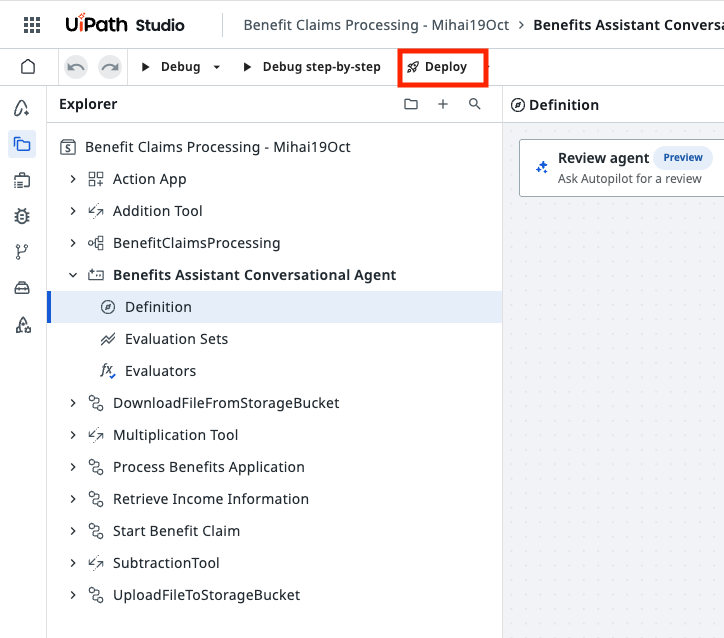
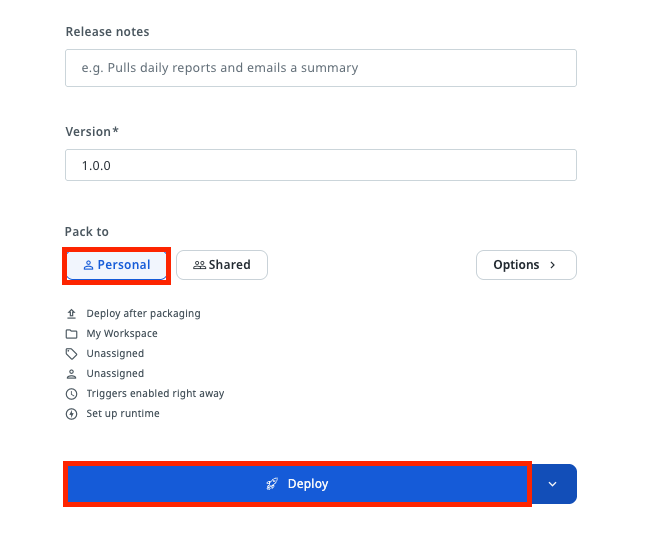
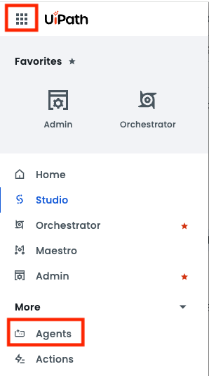
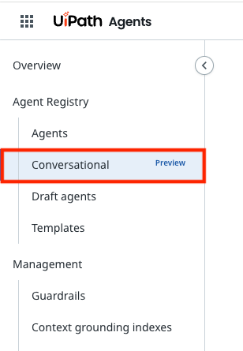
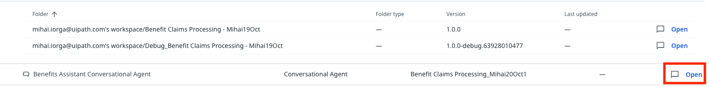
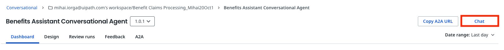
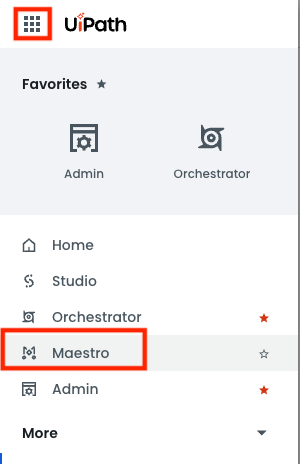
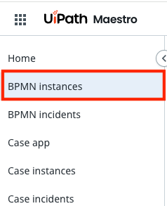
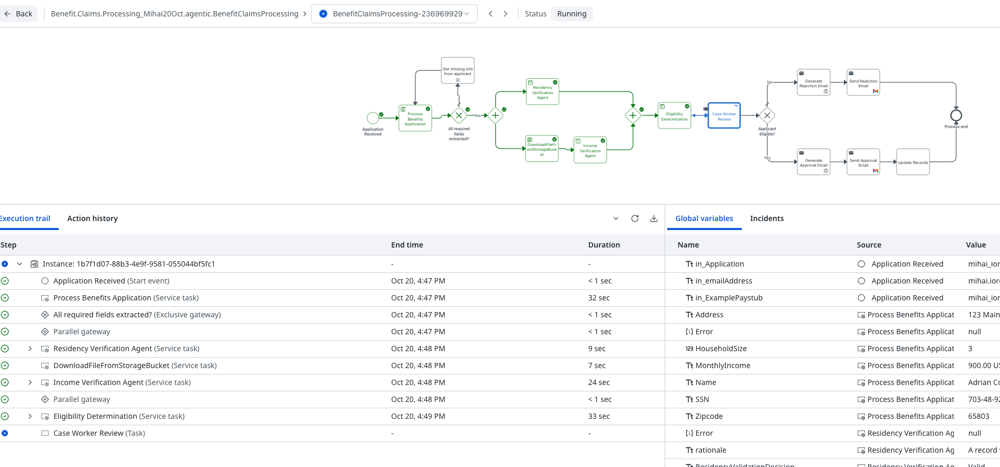

# Publish the Solution

!!! tip "Here is our plan for this lesson:"

    1. Deploy the **Benefit Claims Processing** solution from **Studio Web** to your personal workspace
    2. Run the process end to end

## Goal

Until now, everything ran in **Debug** mode inside Studio Web. In this lesson you'll publish the
**Benefit Claims Processing** solution and deploy it, so the process, the agents, the robots and the
Action App run as a real automation in **Orchestrator**, outside the designer.

## Publish vs. deploy

A [UiPath Solution](https://docs.uipath.com/solutions-management/automation-cloud/latest/user-guide/solutions-management-overview)
goes through three stages on its way to production:

| Stage | What happens | Where |
| :--- | :--- | :--- |
| **Publish** | Studio Web packs all the projects of the solution into one versioned **solution package** | Studio Web, then the tenant's **Solutions** list |
| **Deploy** | The package is installed into an **Orchestrator** folder. You choose the folder and map the resources (connections, storage buckets, indexes) | **Orchestrator** → **Solutions** |
| **Activate** | The deployed processes, agents and apps become available and can start running | **Orchestrator** → **Solutions** |

Each time you publish, you get a new version of the package. You can then upgrade an existing
deployment to that version, instead of deploying from scratch.

## Steps

### 1. Check the solution for errors

Studio Web only publishes a solution when all its projects are valid.

1. Open your **Benefit Claims Processing - &lt;Your Name&gt;** solution in **Studio Web**.
2. Check the Explorer and the **Problems** panel for errors or warnings in any project.
3. Fix any errors before you continue.

### 2. Deploy the solution

1. In the Studio Web toolbar, click **Deploy**.

    { .screenshot }

2. Choose the deployment destination **Personal** and click **Deploy**.

    - **Personal** packs and deploys the solution into your own **personal workspace**. Only you can see and run it, which is all you need for this exercise.
    - **Shared** publishes the package to a shared feed (the tenant feed or a folder feed) and deploys it into a shared **Orchestrator** folder, where other users with access to that folder can run it. It requires permissions to create solution folders and deployments in the tenant.

    { .screenshot }

### 3. Run the process end to end

Now register a real application through the deployed **Benefits Assistant Conversational Agent** and
follow it through the whole process.

1. In **Automation Cloud**, go to **Agents** → **Conversational**.

    { .screenshot style="display: inline-block; width: 45%; margin: 1rem 2%; vertical-align: top;" }
    { .screenshot style="display: inline-block; width: 45%; margin: 1rem 2%; vertical-align: top;" }

2. Find the **Benefits Assistant Conversational Agent** and click **Open**, then **Chat**.

    { .screenshot width="900" }

    { .screenshot width="900" }

3. Register a new application, the same way you did in [lesson 10](10-benefit-claims-assistant-conversational-agent.md):
    - type `I'd like to apply for SNAP benefits.`
    - give **your own** email address, so you receive the final email
    - attach [Sample application.pdf](dependencies/Sample%20application.pdf){ download="Sample application.pdf" } when the agent asks for the application
    - attach [Sample pay stub.png](dependencies/Sample%20pay%20stub.png){ download="Sample pay stub.png" } when it asks for the paystub
    - check the summary and answer `yes`
4. Wait until the agent confirms that the application was submitted.

5. Open **Maestro** and find the new **BenefitClaimsProcessing** instance. Follow it through the robot and the three agents, until it stops at the **Case Worker Review** task.

    { .screenshot style="display: inline-block; width: 45%; margin: 1rem 2%; vertical-align: top;" }
    { .screenshot style="display: inline-block; width: 45%; margin: 1rem 2%; vertical-align: top;" }

    { .screenshot width="900" }

6. Open the **Case Worker Review** task in **Action Center**, review the agents' conclusions, and approve or reject the application.
7. Check your inbox for the approval or rejection email.
