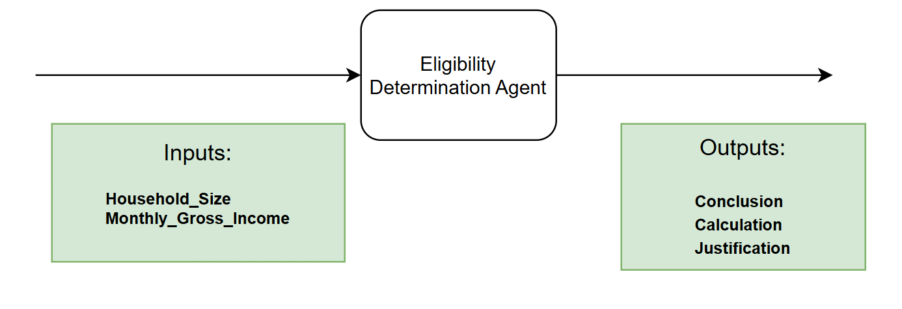
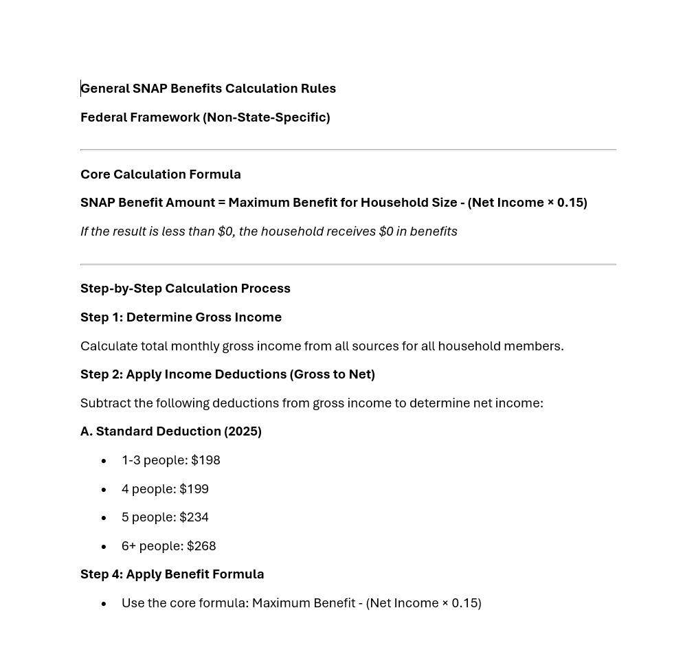
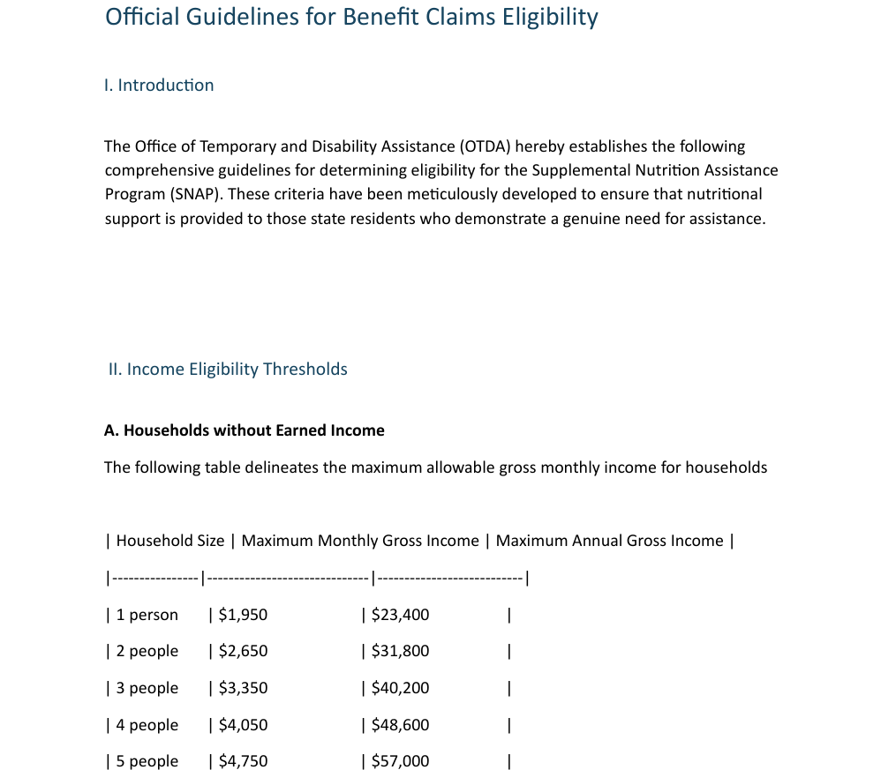
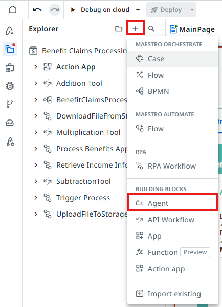
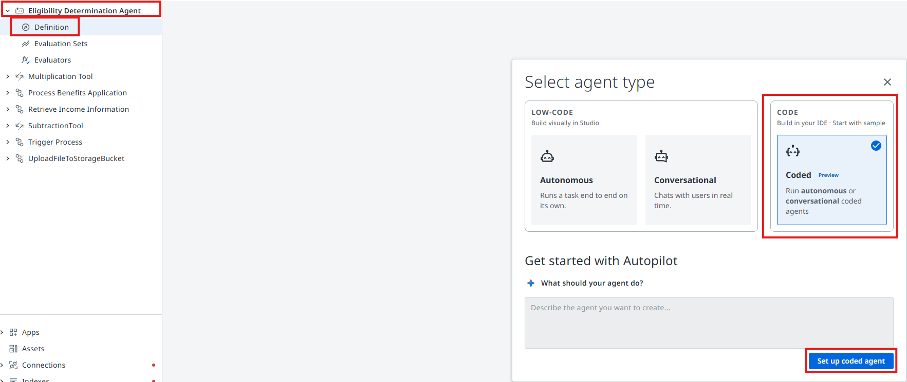
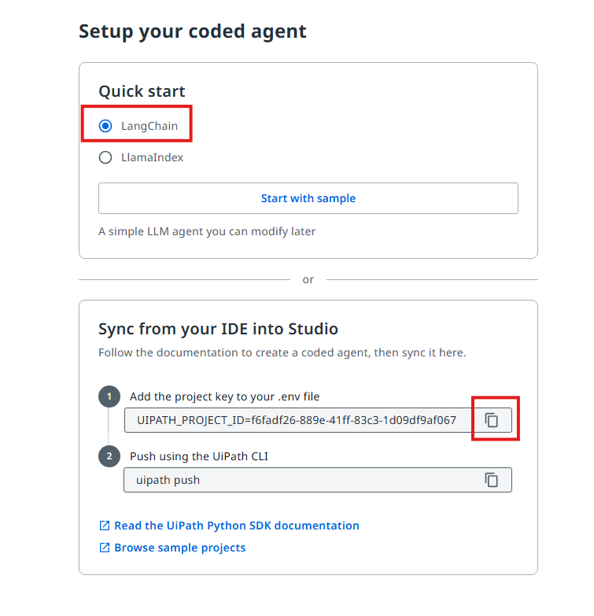
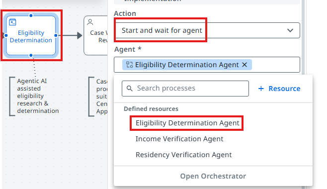
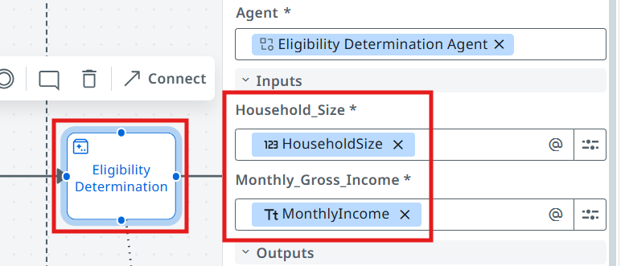
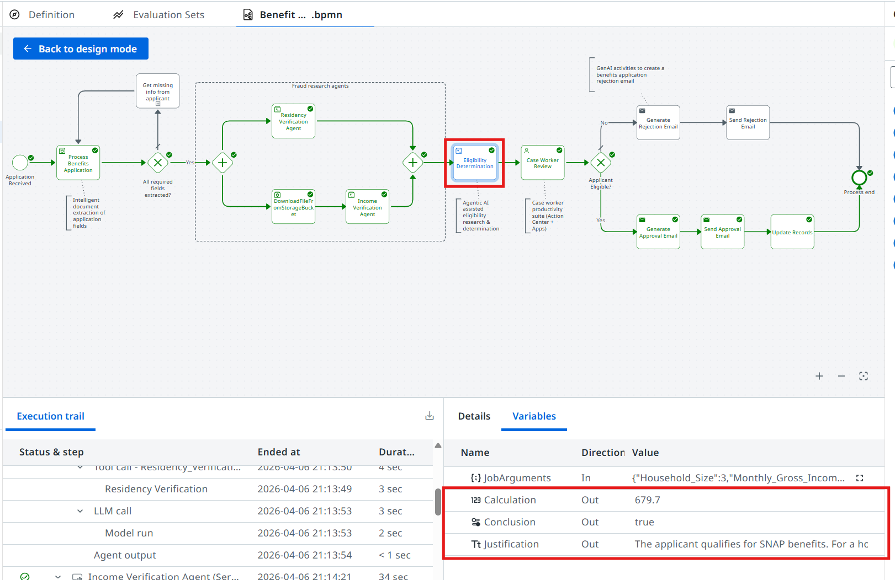

# Build the Eligibility Determination Agent

!!! tip "Here is our plan for this lesson:"

    1. Build a **Benefit Eligibility Determination** AI Agent from scratch as a **coded agent** in Python
        - Agent will use the declared applicant's household size and monthly gross income
        - Using benefit claims guidelines and rules, as part of context grounding, it will decide
          whether the applicant qualifies, what amount they will receive, and a justification
    2. Test the Agent locally, then push it into your solution and debug it in **Studio Web**
    3. Configure the Agent in the Maestro workflow
    4. Use the output of the Agent when presenting the Benefits Claim case to a human for review

## Goal

Implement an agent which decides if the applicant is eligible for benefits and calculates the amount,
according to the guidelines. LLMs are ideal for this job, because the guidelines can be in an
unstructured format. LLMs can be instructed to treat such scenarios accordingly.

## General steps for Eligibility & Calculation

This is a two-phase approach to determine benefits: first verifying household eligibility through
income thresholds, then calculating the actual benefit amount based on net income and household size.

1. **Income Eligibility Check**: Compare the household's gross monthly income against threshold tables based on household size. For example, a single person must have gross income at or below $1,950/month ($23,400/year), while a family of four has a threshold of $4,050/month ($48,600/year). Each additional person adds $700/month to the threshold.
2. **Net Income Calculation**: Apply standard deductions to gross income: $198 for households of 1-3 people, $199 for 4 people, $234 for 5 people, and $268 for 6+ people (2025 rates). This yields the household's net monthly income.
3. **Benefit Determination**: Use the formula below. Maximum benefits range from $300/month for a single person to $1,785/month for 8-person households, with $225 added per additional person beyond 8.

```text
SNAP Benefit = Maximum Benefit for Household Size - (Net Income × 0.15)
```

## Let's build an AI Agent!

Let's use Python to create our **Eligibility Determination Agent**!

[[[
Here is the structure of the agent's inputs and outputs.
|30|
{ .screenshot }
]]]

## Low-code vs. coded

In lessons 4 and 5 you built agents in **Agent Builder**, by filling in forms. A coded agent has the
same building blocks, written in Python instead:

| Agent Builder (low-code) | Coded agent (Python) |
|---|---|
| Input and output arguments | Pydantic `Input` and `Output` classes |
| Model **GPT-5.4**, temperature 0 | `UiPathChat(model="gpt-5.4", temperature=0)`, routed through the LLM Gateway, no API key |
| System prompt and user prompt | `SYSTEM_PROMPT` and `USER_PROMPT_TEMPLATE` strings |
| **Context Grounding** index **Eligibility** | A tool that searches the index with `ContextGroundingRetriever` |
| Addition, Subtraction and Multiplication tools | Three small Python `@tool` functions |
| The agent loop (think → call tool → answer) | `create_agent(...)`, wrapped in a LangGraph `StateGraph` |
| *Debug* in Studio Web | `uip codedagent run` locally, then *Debug* in Studio Web |

## Steps

??? note "Install the prerequisites (skip this if your machine is already set up)"

    You need three tools: **Node.js** (for the `uip` CLI), the **`uip` CLI** itself and **uv**, a fast
    Python package manager. You don't need to install Python separately: uv downloads the right
    version in step 2.

    **Where to run these commands:** in a terminal window.

    - **Windows**: open **PowerShell**: press the **Windows** key, type `PowerShell` and press **Enter**.
    - **Mac**: open **Terminal**: press **Cmd + Space**, type `Terminal` and press **Enter**.

    You can run the install commands from any folder. They install the tools for your whole machine,
    not for one project. After installing a tool, close the terminal and open a new one, so it can find
    the tool.

    For Node.js and uv, **check first**: if the tool is already installed, update it when needed and
    move on. Install it only if the check fails with *"not recognized"* (Windows) or *"command not found"* (Mac).

    **1. Node.js**

    Check:

    ```bash
    node --version
    npm --version
    ```

    - **Both print a version**: Node.js is installed, don't reinstall it. Just make sure `npm` is
      **11.x.x**. If it isn't, upgrade it:

        ```bash
        npm install -g npm@11
        ```

    - **`node` is not found**: install the LTS version:

        === "Windows"

            ```powershell
            winget install OpenJS.NodeJS.LTS
            ```

        === "Mac"

            Download and run the LTS installer from [nodejs.org](https://nodejs.org).

        Open a **new** terminal and run the check again. If `npm` isn't **11.x.x**, upgrade it with the
        command above.

    **2. UiPath CLI**

    No check needed here. This command installs the CLI if it's missing, or updates it to the latest
    version if you already have it:

    ```bash
    npm install -g @uipath/cli@latest
    ```

    **3. uv**

    Check:

    ```bash
    uv --version
    ```

    - **It prints a version**: update it:

        === "Windows"

            ```powershell
            winget upgrade astral-sh.uv
            ```

        === "Mac"

            ```bash
            uv self update
            ```

    - **`uv` is not found**: install it:

        === "Windows"

            ```powershell
            winget install astral-sh.uv
            ```

        === "Mac"

            ```bash
            curl -LsSf https://astral.sh/uv/install.sh | sh
            ```

    **4. Final check**

    Open a **new** terminal, so it finds the newly installed tools, and run:

    ```bash
    node --version
    npm --version
    uip --version
    uv --version
    ```

    Every command prints a version, and `npm` is **11.x.x**.

### 1. Sign in to your tenant

Open a terminal (**PowerShell** on Windows, **Terminal** on Mac) and check whether you're already
signed in:

```bash
uip login status
```

If it shows **Logged in** for tenant **AgenticWorkshop**, you're done. Otherwise sign in. A browser
window opens, complete the sign-in there:

```bash
uip login --authority https://cloud.uipath.com --organization tpenlabs -t AgenticWorkshop
```

Run `uip login status` again. It should now show **Logged in** for tenant **AgenticWorkshop**.

### 2. Create the project folder

In the same terminal, go to your **Desktop**, create an empty folder for the agent and a Python
virtual environment inside it.
The virtual environment keeps this agent's packages separate from everything else on your machine.
It's the coded counterpart of the dependencies Studio Web manages for you.

=== "Windows"

    ```powershell
    cd ([Environment]::GetFolderPath("Desktop"))
    mkdir eligibility-determination-coded-agent
    cd eligibility-determination-coded-agent
    uv venv --python 3.13 --managed-python
    .venv\Scripts\activate
    ```

=== "Mac"

    ```bash
    cd ~/Desktop
    mkdir eligibility-determination-coded-agent
    cd eligibility-determination-coded-agent
    uv venv --python 3.13 --managed-python
    source .venv/bin/activate
    ```

`--managed-python` makes uv download its own Python 3.13 instead of picking whatever is already
installed. Coded agents need Python 3.11 to 3.13.

!!! tip "Run the rest of the commands here"
    From now on, run every command in **this folder**, with the virtual environment active. Your
    prompt shows `(eligibility-determination-coded-agent)`. If you open a new terminal, go back into
    the folder and activate it again:

    === "Windows"

        ```powershell
        cd (Join-Path ([Environment]::GetFolderPath("Desktop")) "eligibility-determination-coded-agent")
        .venv\Scripts\activate
        ```

    === "Mac"

        ```bash
        cd ~/Desktop/eligibility-determination-coded-agent
        source .venv/bin/activate
        ```

!!! warning "Windows: running scripts is disabled"
    If activation fails with *"running scripts is disabled on this system"*, run this once, then
    activate again:

    ```powershell
    Set-ExecutionPolicy -Scope CurrentUser RemoteSigned
    ```

### 3. Scaffold the project

Install the UiPath LangGraph integration, point the CLI at your virtual environment and create the
project files:

```bash
uv pip install uipath-langchain
uip codedagent setup --force
uip codedagent new eligibility-determination-coded-agent
uv sync
```

- `uipath-langchain` brings in the UiPath SDK, LangGraph and LangChain. Installing it first makes
  `uip codedagent new` produce a LangGraph template.
- `uip codedagent new` creates `main.py`, `langgraph.json` and `pyproject.toml` in the **current** folder.
- `uv sync` installs exactly what `pyproject.toml` lists and pins the versions in `uv.lock`, the file
  Studio Web uses later to install the same versions in the cloud.

Open the folder in your code editor. In `pyproject.toml`, replace the placeholder author
(`John Doe`) with your own name:

```toml
authors = [{ name = "Your Name" }]
```

### 4. Start main.py: imports and settings

Delete everything in `main.py`. Start with the imports and three settings: the model and the
**Context Grounding** index the agent will search.

```python
"""SNAP Eligibility Determination agent (LangGraph)."""

from langchain.agents import create_agent
from langchain_core.messages import HumanMessage
from langchain_core.tools import tool
from langgraph.graph import END, START, StateGraph
from pydantic import BaseModel, Field
from uipath_langchain.chat.models import UiPathChat
from uipath_langchain.retrievers import ContextGroundingRetriever

MODEL = "gpt-5.4"
INDEX_NAME = "Eligibility"
INDEX_FOLDER = "Benefit Claims"
```

!!! note "Where is the index?"
    The **Eligibility** index lives in the Orchestrator folder **Benefit Claims**. To check it, run:

    ```bash
    uip context-grounding list --folder-path "Benefit Claims"
    ```

    If your trainer gives you a different folder, change `INDEX_FOLDER`.

### 5. Define the input and output

**Agent arguments** let your agent take in information about a business case and return a result, just
as you might have activities or processes do. This can allow you to pass information from a trigger in
Orchestrator or use the output of an agent to launch another automation.

In a coded agent the arguments are two Python classes, `Input` and `Output`. `Field(description=...)`
works like an argument description, and the LLM reads it too. Add them below the settings:

```python
# ---------- Input / Output ----------
class Input(BaseModel):
    Household_Size: int = Field(
        description="The number of people living in the applicant's house"
    )
    Monthly_Gross_Income: str = Field(
        description="The amount of money the applicant's household makes in a month"
    )


class Output(BaseModel):
    Conclusion: bool = Field(
        description="Result of criteria evaluation against provided context"
    )
    Justification: str = Field(
        description="An explanation for the conclusion, or of the inability to verify the criteria."
    )
    Calculation: float | None = Field(
        default=None,
        description="The amount of money the applicant is entitled to per month, if they are determined eligible for benefits.",
    )


class State(Input):
    """Graph state = the input fields plus the output fields filled in by the agent."""

    Conclusion: bool | None = None
    Justification: str | None = None
    Calculation: float | None = None
```

Fields without a default (`Household_Size`, `Conclusion`, `Justification`) are required. `State` is
what the graph carries around internally: the inputs plus the outputs the agent fills in.

## Configuring Agent's Prompts

[[[

|30|
> Precision in prompts, like in coding, leads to powerful and predictable results. If your prompt is
> messy, expect messy output. Treat it like code, and write every word with purpose!
>
> *(another advice from gpt-4o)*
]]]

First, let's understand the difference between **System prompt** and **User prompt**.

- **System prompt**: describes in natural language the agent's role, goal and constraints: the rules it follows and when to use its tools and context.
- **User prompt**: structures how the inputs are passed to the agent, so the system prompt can refer to them.

### 6. Add the prompts

The System Prompt below ends with one line that tells the model which tool reads the "Eligibility"
context. In the User Prompt, `{Household_Size}` and `{Monthly_Gross_Income}` are placeholders that
Python's `.format()` fills in with the agent's inputs:

```python
# ---------- Prompts ----------
SYSTEM_PROMPT = """#Role
You are a decision agent whose role is to evaluate if an applicant meets the eligibility criteria for Supplemental Nutrition Assistance Program (SNAP) benefits. The eligibility criteria is specified in the "Eligibility" context.

#Goals
Assess whether the given applicant information qualifies them for SNAP benefits. Output a conclusion along with an explanation for the decision. For qualified applicants, calculate the monthly benefit amount.

# Instructions
1. Determine the net income. Use the ##SNAP Eligibility## context to do this.
2. Determine if the applicant qualifies for benefits, according to the thresholds from the context.
- Set the Boolean value of ##Conclusion## to True if they qualify, or False if they don't.
3. Set the string value of ##Justification## to your explanation of the eligibility recommendation.
If they qualify for benefits:
 a. Calculate the maximum benefit amount for the household size.
 b. Set the value of ##Calculation## to the final benefit amount.
If they don't qualify for benefits:
 a. Set the value of ##Calculation## to "0".

##Calculation Rules
**DO NOT** make calculations directly, instead use the available tools (**Addition Tool**, **Subtraction Tool**, **Multiplication tool**) to make calculations.

Use the search_eligibility_context tool to read the "Eligibility" context."""

USER_PROMPT_TEMPLATE = (
    "Decide whether this applicant qualifies for SNAP benefits:\n"
    "Household Size: {Household_Size}\n"
    "Monthly Gross Income: {Monthly_Gross_Income}"
)
```

## Context Grounding

[Context Grounding](https://docs.uipath.com/automation-cloud/automation-cloud/latest/admin-guide/about-context-grounding)
is a component of the UiPath AI Trust Layer which allows you to bring in your data to generate more
accurate, reliable GenAI predictions.

You can create representative
[indexes](https://docs.uipath.com/orchestrator/automation-cloud/latest/user-guide/about-indexes) and
embeddings of business data that UiPath GenAI features can reference for contextual evidence at
runtime. An index is a searchable copy of your documents: when the agent asks a question, it gets
back the passages that match best.

In this case, we are going to use context grounding to provide the agent with the Benefit Eligibility
criteria and calculation rules, to enable it to make the right decisions.

The **Eligibility Criteria** and **Benefit Calculation Rules** documents are indexed inside the
**Eligibility** context grounding index.

[[[
Benefit Calculation Rules.
|50|
{ .screenshot }
]]]

[[[
Eligibility Criteria.
|50|
{ .screenshot }
]]]

A coded agent reaches the index through a **tool**: the LLM decides what to search for, and the tool
returns the most relevant passages.

## Tools

Agent by itself is good at making decisions and analyzing data. But LLMs naturally can't go and
interact with databases and applications... yet. We are going to use
[tools](https://docs.uipath.com/agents/automation-cloud/latest/user-guide/agent-tools) for that. Tools
offer agents both access to critical context from data stored in business applications, and the ability
to execute actions based on objectives outlined in the prompt. Tools are how the agent's reasoning and
planning can turn into action.

### 7. Add the tools

Four tools: one searches the **Eligibility** index, and three do the arithmetic the benefit amount
needs. The **docstring** of each tool is the description the LLM reads to decide when to use it.

!!! note "Why local math tools?"
    You could give the agent RPA or API workflows as tools for the arithmetic. We are going to use
    Python functions instead, because they run inside the agent: they're faster, and they don't start
    an Orchestrator job for every calculation. The prompt rule "**DO NOT** make calculations directly"
    stays, so the LLM still has to use a tool for every step.

```python
# ---------- Tools ----------
@tool
async def search_eligibility_context(query: str) -> str:
    """Search the "Eligibility" context (SNAP eligibility rules: deductions,
    income thresholds and maximum benefit amounts by household size).

    Args:
        query: Natural-language question about the SNAP eligibility rules.
    """
    retriever = ContextGroundingRetriever(
        index_name=INDEX_NAME,
        folder_path=INDEX_FOLDER,
        number_of_results=3,
    )
    documents = await retriever.ainvoke(query)
    return "\n\n".join(doc.page_content for doc in documents)


@tool
def addition_tool(FirstValue: float, SecondValue: float) -> dict:
    """Addition Tool: adds two numbers and returns FirstValue + SecondValue."""
    return {"AdditionResult": FirstValue + SecondValue}


@tool
def subtraction_tool(FirstValue: float, SecondValue: float) -> dict:
    """Subtraction Tool: subtracts two numbers and returns FirstValue - SecondValue."""
    return {"SubtractionResult": FirstValue - SecondValue}


@tool
def multiplication_tool(FirstValue: float, SecondValue: float) -> dict:
    """Multiplication tool: multiplies two numbers and returns FirstValue * SecondValue."""
    return {"MultiplicationResult": FirstValue * SecondValue}


TOOLS = [search_eligibility_context, addition_tool, subtraction_tool, multiplication_tool]
```

- `number_of_results=3` returns the three most relevant passages. The default would be 10.

### 8. Build the agent and the graph

`create_agent` runs the familiar loop: the LLM reads the prompt, calls tools, reads the results and
repeats until it can answer. `response_format=Output` makes it return a validated `Output` object.

```python
# ---------- Agent ----------
async def determine_eligibility(state: State) -> dict:
    # The LLM and the ReAct agent are created inside the node (never at import time).
    llm = UiPathChat(model=MODEL, temperature=0)
    agent = create_agent(
        model=llm,
        tools=TOOLS,
        system_prompt=SYSTEM_PROMPT,
        response_format=Output,
    )
    user_prompt = USER_PROMPT_TEMPLATE.format(
        Household_Size=state.Household_Size,
        Monthly_Gross_Income=state.Monthly_Gross_Income,
    )
    result = await agent.ainvoke(
        {"messages": [HumanMessage(content=user_prompt)]},
        config={"recursion_limit": 50},  # up to 25 agent iterations
    )
    output: Output = result["structured_response"]
    return output.model_dump()
```

The graph wraps the agent in a single step and tells UiPath what the inputs and outputs are:

```python
# ---------- Graph ----------
builder = StateGraph(State, input_schema=Input, output_schema=Output)
builder.add_node("determine_eligibility", determine_eligibility)
builder.add_edge(START, "determine_eligibility")
builder.add_edge("determine_eligibility", END)

graph = builder.compile()
```

!!! warning "Create the LLM inside the function"
    `UiPathChat(...)` needs your UiPath login. Creating it at the top of the file would try to
    authenticate as soon as the file is imported, and the next step would fail.

??? note "The complete main.py (to compare with yours)"

    ```python
    """SNAP Eligibility Determination agent (LangGraph)."""

    from langchain.agents import create_agent
    from langchain_core.messages import HumanMessage
    from langchain_core.tools import tool
    from langgraph.graph import END, START, StateGraph
    from pydantic import BaseModel, Field
    from uipath_langchain.chat.models import UiPathChat
    from uipath_langchain.retrievers import ContextGroundingRetriever

    MODEL = "gpt-5.4"
    INDEX_NAME = "Eligibility"
    INDEX_FOLDER = "Benefit Claims"


    # ---------- Input / Output ----------
    class Input(BaseModel):
        Household_Size: int = Field(
            description="The number of people living in the applicant's house"
        )
        Monthly_Gross_Income: str = Field(
            description="The amount of money the applicant's household makes in a month"
        )


    class Output(BaseModel):
        Conclusion: bool = Field(
            description="Result of criteria evaluation against provided context"
        )
        Justification: str = Field(
            description="An explanation for the conclusion, or of the inability to verify the criteria."
        )
        Calculation: float | None = Field(
            default=None,
            description="The amount of money the applicant is entitled to per month, if they are determined eligible for benefits.",
        )


    class State(Input):
        """Graph state = the input fields plus the output fields filled in by the agent."""

        Conclusion: bool | None = None
        Justification: str | None = None
        Calculation: float | None = None


    # ---------- Prompts ----------
    SYSTEM_PROMPT = """#Role
    You are a decision agent whose role is to evaluate if an applicant meets the eligibility criteria for Supplemental Nutrition Assistance Program (SNAP) benefits. The eligibility criteria is specified in the "Eligibility" context.

    #Goals
    Assess whether the given applicant information qualifies them for SNAP benefits. Output a conclusion along with an explanation for the decision. For qualified applicants, calculate the monthly benefit amount.

    # Instructions
    1. Determine the net income. Use the ##SNAP Eligibility## context to do this.
    2. Determine if the applicant qualifies for benefits, according to the thresholds from the context.
    - Set the Boolean value of ##Conclusion## to True if they qualify, or False if they don't.
    3. Set the string value of ##Justification## to your explanation of the eligibility recommendation.
    If they qualify for benefits:
     a. Calculate the maximum benefit amount for the household size.
     b. Set the value of ##Calculation## to the final benefit amount.
    If they don't qualify for benefits:
     a. Set the value of ##Calculation## to "0".

    ##Calculation Rules
    **DO NOT** make calculations directly, instead use the available tools (**Addition Tool**, **Subtraction Tool**, **Multiplication tool**) to make calculations.

    Use the search_eligibility_context tool to read the "Eligibility" context."""

    USER_PROMPT_TEMPLATE = (
        "Decide whether this applicant qualifies for SNAP benefits:\n"
        "Household Size: {Household_Size}\n"
        "Monthly Gross Income: {Monthly_Gross_Income}"
    )


    # ---------- Tools ----------
    @tool
    async def search_eligibility_context(query: str) -> str:
        """Search the "Eligibility" context (SNAP eligibility rules: deductions,
        income thresholds and maximum benefit amounts by household size).

        Args:
            query: Natural-language question about the SNAP eligibility rules.
        """
        retriever = ContextGroundingRetriever(
            index_name=INDEX_NAME,
            folder_path=INDEX_FOLDER,
            number_of_results=3,
        )
        documents = await retriever.ainvoke(query)
        return "\n\n".join(doc.page_content for doc in documents)


    @tool
    def addition_tool(FirstValue: float, SecondValue: float) -> dict:
        """Addition Tool: adds two numbers and returns FirstValue + SecondValue."""
        return {"AdditionResult": FirstValue + SecondValue}


    @tool
    def subtraction_tool(FirstValue: float, SecondValue: float) -> dict:
        """Subtraction Tool: subtracts two numbers and returns FirstValue - SecondValue."""
        return {"SubtractionResult": FirstValue - SecondValue}


    @tool
    def multiplication_tool(FirstValue: float, SecondValue: float) -> dict:
        """Multiplication tool: multiplies two numbers and returns FirstValue * SecondValue."""
        return {"MultiplicationResult": FirstValue * SecondValue}


    TOOLS = [search_eligibility_context, addition_tool, subtraction_tool, multiplication_tool]


    # ---------- Agent ----------
    async def determine_eligibility(state: State) -> dict:
        # The LLM and the ReAct agent are created inside the node (never at import time).
        llm = UiPathChat(model=MODEL, temperature=0)
        agent = create_agent(
            model=llm,
            tools=TOOLS,
            system_prompt=SYSTEM_PROMPT,
            response_format=Output,
        )
        user_prompt = USER_PROMPT_TEMPLATE.format(
            Household_Size=state.Household_Size,
            Monthly_Gross_Income=state.Monthly_Gross_Income,
        )
        result = await agent.ainvoke(
            {"messages": [HumanMessage(content=user_prompt)]},
            config={"recursion_limit": 50},  # up to 25 agent iterations
        )
        output: Output = result["structured_response"]
        return output.model_dump()


    # ---------- Graph ----------
    builder = StateGraph(State, input_schema=Input, output_schema=Output)
    builder.add_node("determine_eligibility", determine_eligibility)
    builder.add_edge(START, "determine_eligibility")
    builder.add_edge("determine_eligibility", END)

    graph = builder.compile()
    ```

### 9. Generate entry points and add the binding

```bash
uip codedagent init
```

`init` reads your `Input` and `Output` classes and generates `entry-points.json`, the argument
schema Studio Web, Orchestrator and Maestro show for the agent.

It also creates an empty `bindings.json`. Replace its content with this, so the index name and
folder can be changed per environment without touching the code. It's the coded counterpart of a
solution resource:

```json
{
  "version": "2.0",
  "resources": [
    {
      "resource": "index",
      "key": "Eligibility.Benefit Claims",
      "value": {
        "name": {
          "defaultValue": "Eligibility",
          "isExpression": false,
          "displayName": "Name"
        },
        "folderPath": {
          "defaultValue": "Benefit Claims",
          "isExpression": false,
          "displayName": "Folder Path"
        }
      },
      "metadata": {
        "ActivityName": "retrieve_async",
        "BindingsVersion": "2.2",
        "DisplayLabel": "FullName"
      }
    }
  ]
}
```

If you changed `INDEX_FOLDER` in step 4, change `folderPath` and the second half of `key` to match.

### 10. Test the agent locally

Time to test it by giving it some sample inputs. Usually you will need to come back multiple times and
improve the prompt in order for it to be more flexible. This way users need to perform less manual
validations and it will work more reliably.

Each command passes the input straight to the agent. The result appears in the terminal when the run
finishes: **Conclusion**, **Justification** and **Calculation**, followed by `✓ Successful execution.`

=== "Qualifies: household of 4"

    === "Windows"

        ```powershell
        uip codedagent run agent '{\"Household_Size\": 4, \"Monthly_Gross_Income\": \"2500\"}'
        ```

    === "Mac"

        ```bash
        uip codedagent run agent '{"Household_Size": 4, "Monthly_Gross_Income": "2500"}'
        ```

    According to the guidelines, the applicant qualifies, because the maximum allowed gross income
    for a household of 4 is $4,050.

    Output should be **Conclusion: true**, **Calculation: 649.85**

=== "Does not qualify: household of 1"

    === "Windows"

        ```powershell
        uip codedagent run agent '{\"Household_Size\": 1, \"Monthly_Gross_Income\": \"2000\"}'
        ```

    === "Mac"

        ```bash
        uip codedagent run agent '{"Household_Size": 1, "Monthly_Gross_Income": "2000"}'
        ```

    According to the guidelines, the applicant does not qualify, because the maximum allowed gross
    income for a household of 1 is $1,950, which the applicant's income exceeds.

    Output should be **Conclusion: false**, **Calculation: 0**

- `agent` is the entry-point name from `langgraph.json`, not the project name.
- Add `--output-file result.json` if you also want to save the result as a JSON file.
- Add `--trace-file trace.jsonl` to save every LLM and tool call. For the household of 4 you'll see
  one search of the index, then `subtraction_tool(2500, 199)`, `multiplication_tool(2301, 0.15)` and
  `subtraction_tool(995, 345.15)`. The tools did the maths, not the LLM.

!!! note "Windows quoting"
    Windows PowerShell 5.1 drops the double quotes inside a JSON argument, so each `"` is written as
    `\"`. In PowerShell 7.3 or newer, use the Mac form instead. Check your version with
    `$PSVersionTable.PSVersion`.

## Adding the agent to your solution

Your agent works on your machine. Next, you copy it into your **Studio Web** solution, next to the
other agents and the Maestro process. `uip codedagent push` uploads the code into a **Coded Agent
project** in the solution. From there you debug and publish it like any other project.

### 11. Create a coded agent project and copy its ID

1. Open your solution in **Studio Web** and add a new **Agent** project: click **+**, then **Agent**
   under **Building Blocks**. Name it **Eligibility Determination Agent**.

    { .screenshot }

2. Open your newly created agent's **Definition** and select the **Coded** agent option, then click
   **Set up coded agent**.

    { .screenshot width="900" }

3. In the new agent definition page, select the **LangChain** option and copy the project ID.

    { .screenshot }

### 12. Link the project and push

Open the `.env` file in the agent folder. Paste the project ID line you copied, so the file contains:

```text
UIPATH_PROJECT_ID=<PROJECT-ID>
```

!!! tip "Mac: can't see the .env file?"
    macOS hides files whose name starts with a dot. To show them in **Finder**, open the agent folder
    and press **Cmd + Shift + .** (period). Press the same keys again to hide them. Or open the agent
    folder in your code editor: most editors show hidden files like `.env` in their file list.

Then push:

```bash
uip codedagent push
```

Push uploads the code and `uv.lock`, and adds the **Eligibility** index to your solution as a
resource. `.env` and `.venv` stay on your machine.

!!! tip "Error: UIPATH_PROJECT_ID not found"
    You ran `push` from another folder. Go back into the agent folder (step 2) and try again.

### 13. Debug it in Studio Web

Refresh **Studio Web** and open the coded agent project. You'll see your `main.py` and the agent's
input and output arguments. Click **Debug** and run both scenarios again:

=== "Qualifies: household of 4"

    ```json
    {"Household_Size": 4, "Monthly_Gross_Income": "2500"}
    ```

    Output should be **Conclusion: true**, **Calculation: 649.85**

=== "Does not qualify: household of 1"

    ```json
    {"Household_Size": 1, "Monthly_Gross_Income": "2000"}
    ```

    Output should be **Conclusion: false**, **Calculation: 0**

The first debug run takes longer, because the Python environment is built in the cloud from `uv.lock`.

## Configuring the Agentic Task in Maestro

Let's get back to Studio and continue editing our Agentic Process.

### 14. Point the task at your agent

[[[
Configure the **Eligibility Determination** task to use our freshly prepared AI Agent! This is done in
the same way as the Robotic task: pick **Agent → Start and wait for agent**, then search for the agent in your
solution.
|50|
{ .screenshot }
]]]

### 15. Map the inputs

[[[
Now we need to pick outputs from the **Process Benefits Application** RPA Task, and add them as inputs
to the Agent — here is how you do it in your Agentic task's **Settings**.
|30|
{ .screenshot }
]]]

In the end:

- Robot's **HouseHoldSize** should map into Agent's **Household_Size**
- Robot's **MonthlyIncome** should map into Agent's **Monthly_Gross_Income**

### 16. Run it

Process is ready for testing — click on the **Debug** button! This time we can check the output of the
**Eligibility Determination Agent**.

{ .screenshot width="900" }

**Time to move to the next one!**
